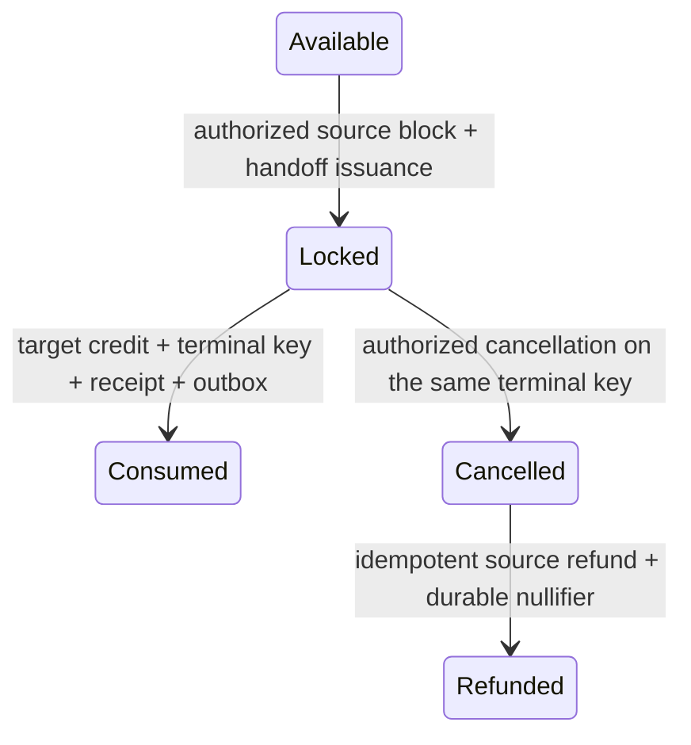
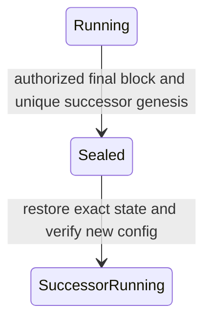

# ADR-008: Cross-session continuation, transfer and evidence composition

Status: protocol RFC with implemented local reference paths. This ADR addresses
issue #7; the shared-store transfer, source authorization, succession and fencing
implementations are described in their linked contracts. The generic envelope
below remains a proposal, separate from the current stored-record codec.
Remote scarce transfers remain outside v1 and require #16/#17 terminal-state
coordination.

## Decision and supported scope

Use four different operations:

| Operation | Authoritative change | Required evidence |
| --- | --- | --- |
| Continuation | Seal one source and create its unique successor | Exact final source state, full successor configuration and authorized compatibility policy |
| Exclusive transfer | Lock/debit at source; one target credit or one cancellation followed by refund | Authorized intent, source effect, finalized issuance and one shared terminal-state key |
| Copyable evidence | No transfer of ownership | Independently checked source histories and typed causal relationships |
| Remote collaboration | Independent commits and asynchronous messages | Authenticated messages, durable inbox/outbox and application-specific terminal-state protocol |

V1 exclusive transfers use one authoritative SessionStore and an explicit target.
A policy-target extension is allowed only when every eligible target competes
over the same store key. A relay, discovery Registry, leaderboard or copy of a
database cannot supply that uniqueness.

Evidence and nonexclusive cosmetic snapshots may be copied. Their possession
does not grant a tradable object, balance, entitlement to mint, or exclusive
consumption right. An achievement issuer needs its own durable claim/nullifier
domain even if its source result is copyable.

## Identity and canonical encoding

Every new protocol commitment uses BLAKE3 over a distinct UTF-8 domain, then
the canonical binary fields. No JSON serialization, display name, endpoint or
hex spelling participates in identity. Integers are unsigned little-endian;
hashes are exactly 32 bytes; byte strings and lists have a u64 element/byte
length prefix; options have a one-byte 0/1 tag; enums have the tags below.
Unknown versions/tags and trailing bytes are rejected.

| Identity | Domain / definition |
| --- | --- |
| Deployment | `myelin:deployment:v1` + network genesis hash + deployment nonce |
| Session genesis | Existing `SessionConfig::commitment()`, including session ID and full application/consensus configuration |
| Application | Existing `ApplicationProfile::commitment()`; retain its artifacts |
| Authority | Existing compiled consensus descriptor commitment and full configuration |
| Object/claim | `myelin:object:v1` + deployment ID + issuer genesis commitment + schema hash + object key |
| Command authorization | `myelin:command-authorization:v1` + deployment ID + session genesis commitment + profile commitment + command ID + canonical payload hash |
| Transfer intent | `myelin:transfer-intent:v1` + fields of TransferIntentV1 below |
| Finalized envelope | `myelin:finalized-effect-envelope:v1` + exact source reference + intent commitment + effect commitment + authorization commitment + handoff ID |
| Successor authorization | `myelin:successor-authorization:v1` + source genesis commitment + command ID + expected source pre-root + complete target config commitment + compatibility/migration artifact digest |
| Composition | `myelin:evidence-composition:v1` + ordered verified source-envelope IDs + ordered typed causal edges + composition program digest |

An application cannot substitute a session display ID for a genesis commitment.
Deployment/network bindings prevent the same signed instruction from being
accepted on another deployment. Protocol and application versions are part of
the committed artifacts; an upgrade creates a new profile/session when semantics
change. Historical identities stay bound to their original artifacts; the
current executable accepts only the current record/store formats listed below.

## Proposed types

These define the proposed generic envelope. The implemented
[reference transfer](reference-transfer.md) enforces authorized source locks and
shared-store intake using its own current types; remote scarce transfer remains
unsupported.

```text
CapabilityV1:
  0 = CopyableEvidence
  1 = NonexclusiveSnapshot
  2 = ExclusiveRight

CausalEdgeV1:
  source_envelope_id, target_envelope_id: Hash32
  kind: u8 = 0 (evidence), 1 (continuation), 2 (transfer)
  policy_digest: Hash32

TargetV1:
  0 = ExactSession { deployment_id, genesis_commitment, session_id }
  1 = SharedStorePolicy { deployment_id, uniqueness_domain, policy_commitment }

TransferIntentV1:
  version: u16 = 1
  deployment_id: Hash32
  source_session_id: Hash32
  source_genesis_commitment: Hash32
  source_profile_commitment: Hash32
  source_authority_commitment: Hash32
  capability: CapabilityV1
  actor: Hash32
  participants: sorted_unique<Hash32>  // includes actor; IDs, not login secrets
  object_id: Hash32
  object_version: u64
  command_id: Hash32
  nonce: Hash32
  target: TargetV1
  payload_schema: Hash32
  payload: bounded bytes             // amount/components encoded by schema
  authorization_policy: Hash32
  expires_at_target_timestamp_ms: u64
  evidence_requirement: optional {
    source_message_id, pipeline_commitment, minimum_stage_index: u16
  }

AuthorizationV1:
  intent_commitment: Hash32
  policy_artifact: Hash32
  bounded credentials/proofs         // verified by the source application policy

SourceReferenceV1:
  deployment_id, session_id, genesis_commitment: Hash32
  block_height: u64
  block_hash, post_state_root: Hash32
  profile_commitment, authority_commitment: Hash32

FinalizedEffectEnvelopeV1:
  version: u16 = 1
  source: SourceReferenceV1
  intent: TransferIntentV1
  authorization_commitment: Hash32
  effect_commitment: Hash32          // source debit/lock or explicit copy policy
  handoff_id: Hash32
  source_block_and_finality_proof
  referenced_artifact_digests
  evidence_receipts                 // only when required by the intent
```

Authorization precedes execution and signs the intent, not its future block
hash. The source block commits the authorized intent and execution effect.
After finality, the external envelope adds the exact block hash/proof. This
avoids a self-referential block hash. The envelope is immutable; progressing
availability or delivery status is stored separately.

The source validator checks deployment/genesis/profile, actor authorization,
object/version, target, complete payload, expiry, nonce and command uniqueness.
For ExclusiveRight it also checks the actual source lock/debit. A nonempty
authorization byte string is not sufficient. CopyableEvidence uses a different
policy and cannot later be promoted to ExclusiveRight by an intake adapter.

A target first verifies source identity and proof under an independently trusted
genesis/authority policy, then validates capability, schema, target, evidence and
expiry. Economic intake also checks the source disposition and atomically
records terminal consumption with the target effect. Schema conversion belongs
to a named, versioned application adapter.

## State machines and atomicity



Consumption and cancellation compare-and-swap the same shared-store key.
Cancellation permanently prevents consumption, including a backdated target
block. Expiry alone never refunds or erases a lock. Refund is a separate,
authorized source transition that proves cancellation and cannot execute twice.
Unknown responses retain the same ID and reservation; they do not authorize a
new issuance, cancellation or refund.

Source state, issuance, source command receipt and outbox commit atomically.
Target state, consumed marker, target receipt and outbox commit atomically.
There is no atomic transaction joining two independent stores. Queue delivery
is at least once; application effects are deduplicated by durable identities.



A same-codec rule change still requires compatibility authorization. Different
codecs/roots need a separate migration artifact and receipt; an empty season
reset cannot impersonate an identical-root continuation. Source history retains
its original verifier. Outstanding handoffs and outbox work retain their source
identity after sealing. Successor creation must name which component reconciles
those obligations; it cannot duplicate or discard them.

Command IDs are session-scoped, while economic reward/claim nullifiers may need
to outlive sessions. New session IDs do not reset the economic uniqueness domain.
Old signatures cannot authorize successor actions. Pending commands require
fresh authorization or an explicit authorized transfer.

## Time, failure and trust assumptions

- Intake expiry compares the proposed target block timestamp to the intent
  deadline. Equality is accepted. Source issuance requires a
  deadline strictly after its source timestamp. Target timestamps are monotonic
  and subject to configured future drift; they are not a trusted wall clock.
- Logical ticks, frame cursor, wall-clock observations and commit timestamps are
  separate values. Changing batching must not change simulation rules or scores.
- Shared-store atomicity comes from the storage backend, including its durable
  WAL and one serialization domain. A snapshot copied to another host is a
  different domain until a fencing authority makes one writer canonical.
- Consensus proves that the configured authority/quorum accepted a block. The
  application verifier proves the source/target policy. DA makes required data
  retrievable under its stated assumptions. CKB enforcement requires actual
  custody/court scripts and transaction receipts. None substitutes for another.
- Host/executor policies may be malicious or buggy. Imports require bounded
  parsing, artifact verification and execution isolation. Signer credentials
  stay outside exported bundles. Private game information must not be published
  while it affects an ongoing match.
- Partitions and unavailable authorities may halt work indefinitely. Safety is
  preserved by leaving uncertain rights locked/pending, not by inventing a
  timeout refund. Losing all authoritative storage is outside ordinary crash
  recovery; backups must preserve nullifiers and terminal records.

## Errors and retry rules

Names below define protocol categories; the current APIs expose some as
`Continuity`, `Conflict`, `Recovery` or `Corrupt` with a reason.

| Category | Meaning | Action |
| --- | --- | --- |
| IdentityMismatch | Wrong deployment, genesis, profile, object/version or source block | Reject; do not rewrite the signed intent |
| UnsupportedCapability | Remote scarce claim, unimplemented migration or wrong capability | Reject explicitly |
| UnauthorizedEffect | Invalid actor proof, missing source lock/debit or unauthorized successor | Reject without writes |
| DuplicateIntent | Same command/nonce/effect repeated | Return exact prior result or reject conflicting bytes |
| WrongTarget | Explicit target or shared policy does not match | Reject |
| Expired | Target timestamp is beyond the deadline | Reject intake; keep source disposition |
| EvidenceMissing | Required receipt/artifact unavailable | Remain pending; fetch exact dependency |
| EvidenceMismatch | Wrong pipeline, stage, source or artifact | Reject; do not downgrade evidence policy |
| AlreadyConsumed | Terminal key names a target commit | Reconcile that exact target block |
| Cancelled | Terminal key permanently forbids intake | Only the authorized source refund may proceed |
| StaleConstruction | Head changed after request construction | Rebuild from the original authorized command |
| OutcomeUnknown | A commit may have happened | Retain reservation; query authoritative receipt and fence the previous writer before proving absence |
| CorruptHistory | Missing/reset/mismatched marker, proof, receipt or checkpoint | Close writer; restore/repair from authenticated history |
| BudgetExceeded | Input, effect, snapshot, dependency or operational budget exhausted | Reject or return a resumable unverified cursor |
| WriterFenced | Ownership epoch is no longer current | Stop storage/signing/external effects |

## Concrete topologies

1. **One store, two rooms.** Room A locks item X and issues an exact-target intent.
   B credits X while consuming the shared terminal key. A crash after B's WAL
   commit but before its HTTP reply is reconciled from B's receipt. Resending
   the same intent cannot credit X again.
2. **One store, policy targets.** B and C may both prepare against the same
   unconsumed handoff. Their commits contend on the same key. Exactly one
   target state/receipt/outbox may advance; the loser reconciles the winner.
3. **Separate stores.** A can export copyable result evidence for B to verify.
   V1 rejects scarce-right intake across those stores. A relay ACK and B's local
   marker cannot establish that A will never refund. A future coordinator or
   on-chain terminal-state protocol must settle that question.
4. **Different authorities.** B verifies A's source block using A's trusted
   descriptor and artifact set, then finalizes its own block under B's descriptor.
   No signatures are concatenated into an invented shared quorum.
5. **Sealed source with outstanding messages.** A seals into A2 while its
   already-issued handoff to B is pending. The original source block, policy and
   uniqueness key remain addressable. A2 may reconcile under an explicit
   obligation policy, but cannot reissue the same right under a fresh ID.

## Current storage format

Only MREC envelope 13, session block 6 and RocksDB schema 15 are accepted.
Every config binds resource limits and an explicit protocol-effects policy.
Every block records its original snapshot byte count, and every successor carries
its typed transition receipt. Historical record/store decoders and schema-marker
upgrade APIs have been removed. Older data must remain with its original binary;
the current executable does not import or upgrade it.

## Conformance evidence

Applications bind an explicit source-effect policy; storing a handoff alone does
not authorize economic transfer. See [source effects](protocol-effects.md).

The [public commitment vectors](../../fixtures/protocol/cross-session-v1.json)
specify ordered fields, canonical preimage bytes and expected hashes. Run
`cargo run --locked -p myelin-session --example cross_session_vectors` to
verify them without a platform database or running service. After Cargo
dependencies are cached, add `--offline` for disconnected verification.
The reference encoder defines commitment encoding only; it does not authenticate
actors, verify source proofs, or admit transfers. The envelope version is fixed
by its domain; the intent's u16 version is also included in its preimage. The
participants list is sorted/unique. Composition source IDs and edges preserve
their declared order; verification rejects duplicate nodes and cyclic edges.
The new envelope remains proposed until its corresponding types, bounded codec,
authorization and offline verifier pass their own vectors and negative tests.

Acceptance of this ADR does not complete implementation issues #9–#15 or remote
protocol issues #16/#17. Deployment of a CKB bridge/court remains a separate
acceptance path.
