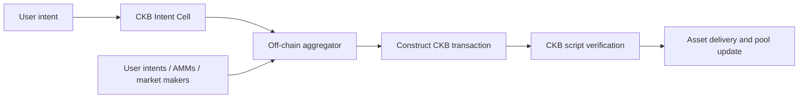
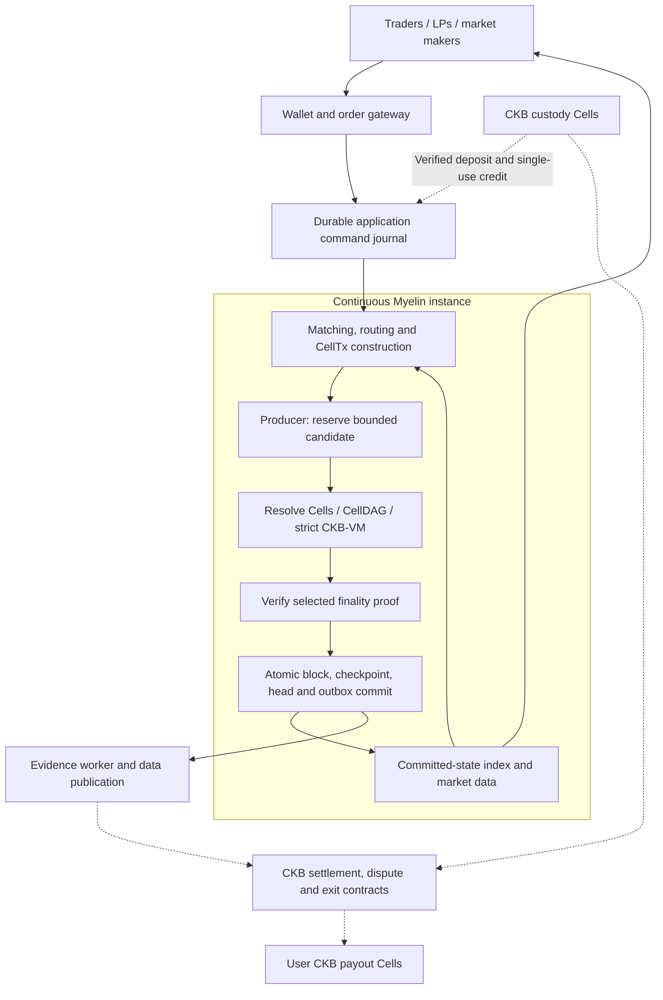

# Myelin DEX architecture

Status: proposed application architecture, grounded in the current Myelin repository.

## Architecture decision

Build a persistent, Cell-native spot exchange on Myelin's execution core **with the continuous-chain modules enabled**. Orders, reserved funds, pool reserves, and withdrawals must remain consistent across batches, validator decisions, and process restarts.

The intended composition is:

```text
DEX application
  Signed intents, order lifecycle, matching, routing, AMM rules, market data
                         |
Continuous-chain service
  Bounded production, finality, durable state, recovery, network transport
                         |
Myelin execution core
  CellTx, authenticated conflict resolution, CellDAG, CKB-VM, atomic state
                         |
CKB integration
  Verified funding, asset-specific custody, settlement, disputes, exits
```

The CKB integration is a separate protocol obligation. Enabling the chain modules does not by itself make internal balances redeemable on CKB.

This document describes the target design and its implementation boundaries. It does not claim that Myelin already ships a DEX, a production bridge, or a complete permissionless L2. The [canonical architecture](../MYELIN_ARCHITECTURE.md) remains authoritative for existing runtime behavior.

## Scope and initial deployment

Start with a small number of spot markets in one continuously running Myelin instance. Support funded limit orders and signed market-maker quotations first. Add AMM liquidity after the order and funding lifecycles work end to end. Margin, lending, perpetuals, and cross-instance atomic routing are outside the initial application scope.

Use a single PoA authority for a controlled development deployment. A multi-operator deployment can select the existing closed-validator Tendermint engine, with independently operated validators and the required runtime coordination. Validator participation remains configured; an open user-facing exchange does not imply permissionless validator membership.

Keep markets in one state domain initially. This preserves the possibility of atomic transactions involving multiple markets, subject to current execution and admission limits. Separate market instances would require additional funding, routing, and cross-instance settlement protocols.

## Comparison with UTXOSwap

UTXOSwap's published architecture combines off-chain aggregation with CKB transaction execution. Intent Cells express user constraints; AMM Cells validate pool updates. The aggregator can source liquidity from user intents, AMMs, and private market makers. The litepaper distinguishes the Intent Cell flow from its proposed Open Transaction integration. The public SDK's swap example returns an intent transaction hash. These are architecture references, not a claim that every roadmap feature is deployed. Sources: [UTXOSwap litepaper](https://utxoswap.gitbook.io/en) and [official SDK](https://github.com/UTXOSwap/utxoswap-sdk-js).



The following differences are architectural consequences of that model and the proposed Myelin design:

| Dimension | UTXOSwap reference model | Proposed Myelin DEX |
| --- | --- | --- |
| Authoritative trading state | CKB Cells | Myelin's finalized Cell state; redemption depends on the CKB settlement protocol |
| Matching | Off-chain aggregation | Application matching and routing outside the VM |
| Trade validation | CKB scripts | Myelin CKB-VM execution, with a separately defined L1 enforcement path |
| Confirmation | CKB inclusion and confirmation | Session finality for trading; separate CKB confirmation for deposits and withdrawals |
| Repeated trading | State updates settle through CKB transactions | Many internal updates between funding and withdrawal |
| Liquidity | L1 liquidity used by the constructed transaction | Liquidity explicitly funded into the Myelin state domain |
| Main additional responsibility | Transaction construction and L1 contracts | Continuous ledger operation plus custody, data availability, and exit enforcement |

Intent-based trading is compatible with either architecture. The decisive change is the location of the continuously authoritative ledger. Myelin could instead be used only for simulation or transaction preparation while all trades settle on CKB; that alternative does not require this persistent DEX chain.

## System topology

Solid arrows show the proposed trading path. Dashed arrows show funding and settlement integrations that require DEX-specific protocol work.



The index is derived from committed state. It may provide efficient queries, but its database does not independently authorize a trade or withdrawal. Every response that claims a finalized balance should identify its session, height, and state root.

## Module composition

These crates are reusable capabilities. The DEX host must wire them together and implement the application-specific policies.

| Existing component | Use in this DEX | Boundary |
| --- | --- | --- |
| `myelin-session` | Required | Canonical blocks, application profile, durable head, finality verification, replay, and outbox |
| `myelin-session-producer` | Selected production adapter | Reserve bounded batches and control when production runs |
| `myelin-session-store-rocksdb` | Selected persistence adapter | Atomic commits, synchronous WAL, checkpoints, recovery records, and durable queues |
| `myelin-session-runtime` | Selected composition root | Wire adapters, supervise service health, and gate the writer |
| `myelin-session-network` | Required for the selected multi-node topology | Authenticated closed-peer transport; consensus coordination still belongs to its owner |
| Existing consensus engine | Required finality implementation | PoA for controlled development; closed-validator Tendermint for a multi-operator deployment |
| `myelin-exec`, `myelin-state`, `myelin-mempool` | Execution foundation | Script validation, state transitions, dependency and conflict handling |
| `myelin-wallet-auth` | Reusable identity adapter | Wallet identity and supported signatures; DEX order authorization still needs its own signed schema |
| `myelin-ckb-adapter` | Required for evidence-backed CKB integration | Verify exact transaction receipts, inclusion, configured depth, and canonical-chain checks |
| `myelin-session-escrow` | Reuse where its terms fit | Conserved funded-session accounting and exit interfaces; requires extension or a separate DEX funding layer |

The producer currently carries one candidate through execution, finality, and durable commit before preparing a descendant. Production timing is not a consensus rule. Start with bounded interval production and measure latency, cycle usage, and contention before choosing an interval; this design makes no TPS or latency guarantee.

The application must reconcile its journal with committed command identifiers after recovery. A crash after block commit but before source acknowledgement must not execute the same economic instruction again.

## Application state and authorization

The following are proposed application Cell types, not existing Myelin DEX APIs. Amounts use integer units, with checked arithmetic and explicitly defined rounding. Asset identity must bind the full approved asset semantics rather than a ticker string.

| Proposed Cell | Contents | Principal invariant |
| --- | --- | --- |
| `AssetCell` | Owner, asset identifier, quantity | Only an authorized transition can spend it |
| `OrderCell` | Order ID, owner, market, side, limit, remaining quantity, expiry, reserved input | Remaining funds cannot also appear in available balance |
| `PoolCell` | Pool ID, asset pair, reserves, curve, fee parameters | Every update follows the selected curve and fee rules |
| `LpShareCell` | Owner, pool, share quantity | Minting and burning reconcile with pool share accounting |
| `DepositCreditCell` | Source chain, deposit outpoint, asset, beneficiary, credited amount | The funding event can be credited only once |
| `WithdrawalCell` | Request ID, asset, quantity, exact payout lock, lifecycle state | Requested funds cannot be traded or paid out twice |

The canonical DEX Cell state is the sole authority for internal economic ownership. Funding and redemption derive claims from that state. Do not maintain an independent participant-balance ledger that can authorize payouts inconsistent with the DEX. Any settlement projection must be derived or have equivalence enforced. This is one authority across partitioned Cells, not one global balance Cell.

An order reserves actual asset value either in its own typed state or in an explicitly bound companion Cell. A quantity field alone is not collateral. Choose one representation and enforce it consistently in the application scripts.

Signed commands bind the deployment/session domain, action, owner, unique command identifier, relevant asset or market, quantity and price constraints, expiry, and allowed fees. Partial fills must consume the previous order version and create the remainder. Replays across sessions, markets, or expired orders must fail. Wallet login alone does not authorize a trade.

Pin the trading program, schema, time policy, and resource envelope through the genesis-bound application profile. Use the declared time policy for expiries; do not let a matcher supply an unchecked wall-clock timestamp.

### Partial fill example

A sell order reserves 100 A. A buyer accepts 30 A at a price satisfying both parties' constraints:

```text
Consume:
  Sell order and its reserved 100 A
  Buyer's funded B input

Create atomically:
  Remainder order reserving 70 A
  Buyer's 30 A
  Seller's B proceeds
  Buyer change and explicit fee outputs, as applicable
```

The validator checks authorization, quantities, prices, expiry, fee limits, rounding, and conservation for both assets. A cancellation consumes the same current order state and returns its remaining funds. A competing cancellation and fill cannot both consume that version; the constructed cancellation transaction must reference the surviving remainder. The user's signed command instead targets a stable `order_id`. Partial fills preserve that identity; the builder resolves the current remainder without changing the signed intent. Replacement and terminal-state rules must be explicit. Report cancelled, fully filled, or already cancelled; command receipt alone does not mean cancellation succeeded.

## Matching, ordering, and parallel execution

The matcher searches for executable combinations and constructs candidate transactions. It cannot bypass the scripts by declaring a match successful. The execution layer checks the exact state and witnesses; the finality layer confirms the resulting block; persistence makes that decision recoverable.

For the first implementation, use signed limit constraints and RFQ acceptance as the enforceable execution policy. A displayed order book may help discovery, but this alone does not guarantee global best execution or strict price-time priority. Enforcing either requires a canonical admitted-order set, a committed ordering rule, and checks that reject illegal omissions or reordering. Those policies must be specified before advertising such guarantees.

State partitioning should follow actual ownership and contention:

- Independent orders and funds are parallel candidates when their physical and logical accesses permit it.
- Updates to the same AMM reserves require an ordered transition or one explicitly defined batch update.
- An atomic multi-market trade must validate all legs together; separate successful legs are not an atomic swap.
- Shared fee accumulators, LP supply state, and global balance Cells can become write hotspots. Partition them only where conservation and accounting remain verifiable.

Myelin resolves logical conflict identity from authenticated Cell state and script identity. The application cannot obtain safe parallelism merely by assigning different keys to state that shares an invariant. Cross-type economic relationships must also be enforced by scripts and shared state dependencies where needed.

The current mempool rejects multi-parent admission without a coherent combined-overlay proof. Begin with transactions constructed from a known committed snapshot and supported dependency chains. Carry that snapshot in `ProductionCandidate.base_head`, and call the host's `prepare_block_at` under the writer lock. A changed head requires rebuilding from the original authorized command. Use genesis-required command identities and committed receipts for restart reconciliation; a new transaction hash does not authorize a second command effect. Do not assume arbitrary speculative multi-hop packages already work. See the [canonical execution and admission model](../MYELIN_ARCHITECTURE.md).

## Funding and withdrawal lifecycle

This section defines requirements for the proposed DEX integration. It is not a description of an already deployed bridge.

### Deposit

1. The user locks an approved asset in the exact CKB custody script for this deployment.
2. The evidence adapter verifies the deposit transaction, output, asset semantics, canonical inclusion, and configured confirmation depth.
3. The DEX authenticates the funding event and atomically records its deployment/source-chain/outpoint identity as credited while creating the beneficiary's internal assets. Both creation and consumption of credit Cells must enforce this uniqueness; a worker database alone is insufficient. The claim identifier binds the source chain and deposit outpoint.
4. Only then does the trading API expose the funds as spendable.

All accounting terms must use a selected Myelin checkpoint and a compatible set of recognized CKB funding/payout events. A delayed observer cannot restore funds already authorized for payout.

Confirmation depth is operational evidence, not absolute irreversibility. Define how the deployment halts affected funding paths and reconciles liabilities if a credited deposit is invalidated by a deeper reorganization. Before production funding, specify delayed settlement, funded loss absorption, or another explicit outcome for deposits that have already been traded or withdrawn; halting alone does not replace lost backing.

### Normal withdrawal

1. Consume available internal funds and create a withdrawal request bound to the exact payout lock. Funds remain non-spendable while the request is pending.
2. Finalize the request in Myelin and produce the evidence required by the selected CKB settlement contract.
3. Satisfy that contract's proof, authorization, and any challenge conditions; construct and submit the asset-specific payout transaction.
4. Mark the request settled only after verifying the exact payout transaction and its configured-depth receipt chain.

Retrying a worker must not generate a second economic payout. Once a request is eligible for L1 execution, an internal cancellation cannot simply restore the balance: it needs a protocol that makes the old payout authorization unusable.

For each traded asset, maintain this accounting identity under verified funding and payout events:

```text
credited deposits - finalized withdrawals
  = available balances + order reserves + pool reserves
    + pending withdrawals + undistributed fees
```

Count each unit once. LP shares represent claims on pool reserves, not another copy of the underlying assets. Native CKB trading balances, occupied Cell capacity, and transaction-fee funding require explicit separate accounting where applicable.

### Non-cooperative exit and settlement authority

Select and implement the L1 authorization model before accepting production deposits. A committee-authorized custody deployment depends on its signers. A dispute-enforced design instead needs a complete on-chain adjudication protocol, available replay data, deadlines, and a usable unilateral exit path. A state root or committee signature alone does not prove all transitions valid to CKB.

For the intended stronger exit model, define which checkpoint CKB accepts, how an invalid or stale claim is challenged, how a user obtains the necessary state and witnesses, and how already processed withdrawals are excluded. Specify behavior when the producer, validators, or data providers stop cooperating. Publishing a commitment without the data needed to use it is insufficient.

Normal and emergency exits must share both an authoritative history-selection rule and a single-spend entitlement mechanism. A unique withdrawal ID alone cannot exclude Alice's old-state ownership and Bob's conflicting new-state ownership. Define the accepted checkpoint/epoch and how existing payouts constrain all later exit paths. Worker idempotence is additional protection, not the on-chain authorization rule.

An internal Myelin Cell is not automatically a live CKB Cell. Projecting transaction bytes does not give off-chain outpoints L1 existence, nor does it make a signed internal balance enforceable against a custody lock.

## Confirmation, data availability, and recovery

Expose distinct statuses to users:

| Status | Meaning |
| --- | --- |
| Received | The application journal recorded the command; no fill is promised |
| Session-finalized | The verified transition and exact finality proof were durably committed |
| Settlement-eligible | The selected L1 protocol's evidence and timing requirements are satisfied |
| CKB-settled | The exact payout transaction has verified canonical inclusion and configured confirmations |

Retain the transaction and witness data, state material, profiles, and proofs required for replay and exits. Bind publication records to the committed block and root. Define retention and independent retrieval. Bound all value-changing advancement beyond the latest independently recoverable state, including trades that leave aggregate liabilities unchanged. Halt affected transitions when the configured recovery limit is exceeded. Track session-finalized, independently recoverable, and L1-authorized progress separately; lag limits do not by themselves justify rolling back finalized trades or completed payouts. Myelin 0.31 provides a rechecked operational admission port and canonical-anchor lag checks; the deployment must supply genuine independent recovery evidence and its verifier. Existing DA commitments and certificate structures are foundations, not evidence that independent providers are operating.

On restart, use Myelin's recovery audit before reopening the writer. Rebuild derived market indexes from verified state, reconcile journal reservations against committed commands, and resume evidence and payout jobs idempotently. Node recovery must preserve pending orders and withdrawals as well as balances.

## Existing capabilities and remaining work

| Area | Current repository evidence | DEX work still required |
| --- | --- | --- |
| Cell execution | Strict VM verification, state roots, atomic transitions, conflict scheduling | Trading scripts, asset rules, price and fee arithmetic |
| Continuous service | Session heads, producer, RocksDB, runtime, replay and outbox | DEX host, command journal, indexers, APIs and operational policy |
| Finality | PoA, static committee and Tendermint closed-validator engines | Chosen deployment topology and independently exercised distributed operation |
| Funding | Finalized funding attachment and conserved session ledger | Open user admission, ongoing deposits, multi-asset liabilities and asset adapters |
| Exits | Evidence-bound construction; built-in cooperative CKB-capacity exit | Typed-token payout construction, deployed custody enforcement, partial and unilateral withdrawals |
| DA and disputes | Certificate core, evidence and court input paths | Independent DA integrations, full adjudication, economics and public deployment |

The current `EscrowTerms` commits a participant/deposit set and one asset descriptor. The built-in `prepare_capacity_exit` explicitly rejects typed-token settlement; such assets require separate builders. A `challenge_window_ms` field is not proof of an implemented unilateral close protocol. See [escrow source](../../session-escrow/src/lib.rs).

The repository currently documents public-testnet evidence for standard and canonical multisig locks, while verifier/court/DA deployment and full disputed-chunk economics remain incomplete. See [repository capability status](../../README.md#current-capabilities-and-limits).

## Implementation sequence and evidence needed

1. **Custody and recovery semantics.** Decide canonical economic ownership, authoritative exit history, normal/emergency single-spend rules, DA failure behavior, and reorg loss handling before fixing funding interfaces. A controlled PoA prototype does not settle these production decisions.
2. **Trading state machine.** Implement funded orders, RFQ acceptance, partial fills, cancellations, and explicit fees. Demonstrate conservation, replay rejection, deterministic rounding, and fill/cancel conflict handling.
3. **Persistent exchange host.** Wire the continuous-chain modules and derived market data. Demonstrate recovery across crashes before and after finality, commit, and journal acknowledgement without duplicate effects.
4. **Asset funding and redemption.** Implement both assets of an initial spot pair, deposit deduplication, pending withdrawal accounting, and exact payout verification. Demonstrate reorg handling and retries without unbacked credits or double payouts.
5. **Enforced exit protocol.** Choose and document the custody trust model. For the stronger dispute-enforced model, deploy and exercise its adjudication, data retrieval, stale-state rejection, and non-cooperative exit paths before making those guarantees.
6. **AMM and routing.** Add curve-specific pool logic, LP accounting, and atomic route validation. Benchmark realistic shared-pool contention and VM costs against the supported admission model.
7. **Multi-operator rehearsal.** Exercise the selected consensus deployment under restart, partition, equivocation, and data-service failure. Measure confirmation latency and backlog behavior before setting service targets.

The first end-to-end prototype uses two assets, two users, and one market: deposit, funded order, partial fill, cancel remainder, withdraw, restart, and replay. Exercise both assets' actual payout formats. Test stale ownership projections, old/new checkpoint conflicts, payout reconstruction after restart, and DA failure while trading existing funds.

The resulting system is a persistent Cell-native exchange with a separately specified CKB funding and settlement protocol. The continuous-chain modules provide market continuity; DEX rules provide trading correctness; deployed custody and exit enforcement determine whether users can redeem their assets.
